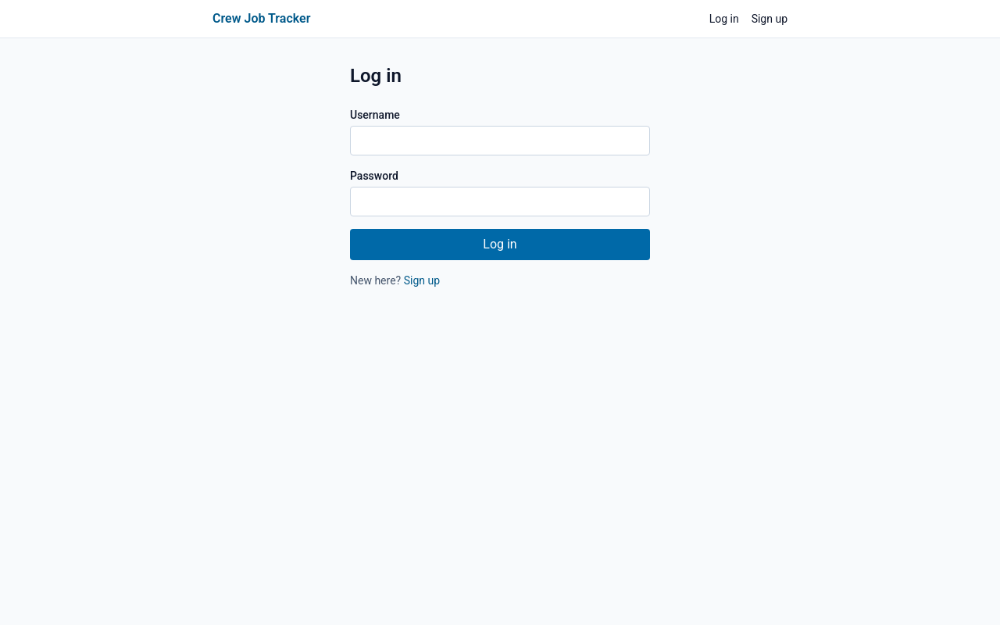
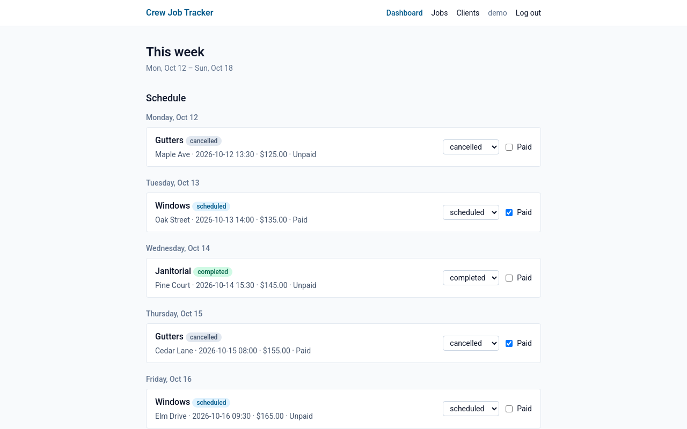
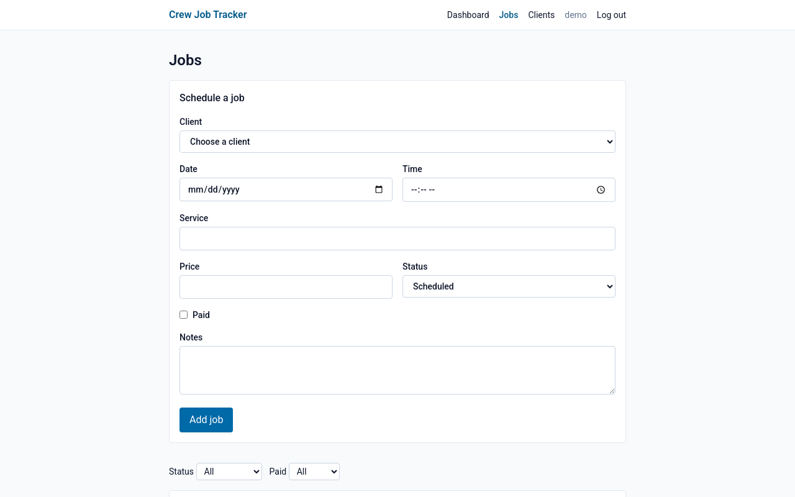
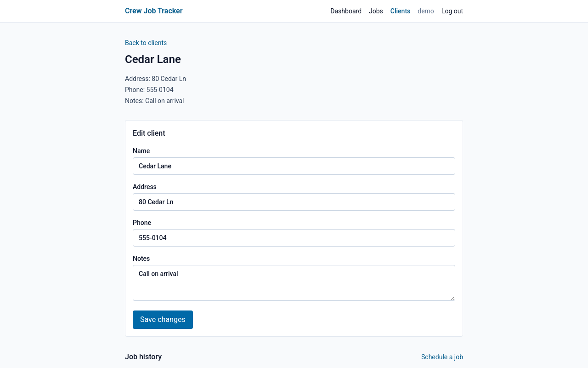

# Crew Job Tracker

Crew Job Tracker is a productivity app for owners of small cleaning or service businesses. It keeps client details and jobs in one place, including what is scheduled this week and what has not been paid. I ran a cleaning business for 3 years, and scheduling and payment tracking were on paper and in text messages.

## Technologies used

API (`server/requirements.txt`):

- Flask 3.1.3
- Flask-SQLAlchemy 3.1.1
- Flask-Migrate 4.1.0
- Flask-Bcrypt 1.0.1
- marshmallow 4.3.1
- psycopg2-binary 2.9.13
- python-dotenv 1.2.4

Client (`client/package.json`):

- React 19
- React DOM 19
- React Router 7
- Vite 8
- Tailwind CSS 4 (`tailwindcss` and `@tailwindcss/vite`)
- `@vitejs/plugin-react`
- `@types/react` and `@types/react-dom` (development dependencies)

## Features

- Sign up, log in, and log out with a server session. Passwords are stored as bcrypt hashes.
- Ownership checks on every client and job. A request for another user's record returns 404.
- Client create, read, update, and delete.
- Job create, read, update, and delete, including the job form.
- A Jobs page with filters for status (`scheduled`, `completed`, `cancelled`) and paid (`true` or `false`).
- A dashboard with this week's schedule (Monday through Sunday) and the list of unpaid jobs.
- Pagination on the client and job lists.

## Setup and run

Python 3 and Node.js are required. PostgreSQL is required only if you point the API at it.

### API with SQLite

From the project root, with no `DATABASE_URL` set, the API uses `server/app.db`:

```bash
python3 -m venv .venv
source .venv/bin/activate
pip install -r server/requirements.txt
flask --app server.app db upgrade -d server/migrations
python -m server.seed
flask --app server.app run --host 127.0.0.1 --port 5000
```

`python -m server.seed` deletes existing rows and creates the user `demo` / `password123`, 5 clients, and 15 jobs. Signup passwords must be at least 8 characters. The `-d` flag tells Flask-Migrate to use `server/migrations` when you run commands from the project root.

### API with PostgreSQL

Copy `server/.env.example` to `server/.env` and set `DATABASE_URL` and `SECRET_KEY`. A `postgres://` or `postgresql://` URL with no driver is rewritten to `postgresql+psycopg2://`. A URL that already names a driver is left as-is. If `SECRET_KEY` is missing, the app logs a warning and uses a dev-only fallback. `SESSION_COOKIE_SECURE` defaults to false. Set it to `true` when the API is served over HTTPS.

```bash
cp server/.env.example server/.env
flask --app server.app db upgrade -d server/migrations
python -m server.seed
flask --app server.app run --host 127.0.0.1 --port 5000
```

### Client

In a second terminal:

```bash
cd client
npm install
npm run dev
```

Open the URL Vite prints, usually `http://127.0.0.1:5173`. Start the API first. The Vite dev server proxies `/api` to `http://127.0.0.1:5000`, so the browser sends the session cookie with each API request.

## API routes

All paths are under `/api`. Authenticated routes require the session cookie and return 401 when it is missing.

| Method | Path | Auth | Description |
| --- | --- | --- | --- |
| POST | `/api/signup` | No | Create an account and start a session. Body: `username`, `email`, and a `password` of at least 8 characters. |
| POST | `/api/login` | No | Start a session. Body: `username`, `password`. |
| DELETE | `/api/logout` | No | End the session. |
| GET | `/api/check_session` | Yes | Return the logged-in user, or 401. |
| GET | `/api/clients` | Yes | List the current user's clients. Query: `page` (default 1), `per_page` (default 10, max 50). Ordered by name, then id. |
| POST | `/api/clients` | Yes | Create a client. Body: `name` (required), `address`, `phone`, `notes`. |
| GET | `/api/clients/<id>` | Yes | One client, including that client's jobs. |
| PATCH | `/api/clients/<id>` | Yes | Update a client. |
| DELETE | `/api/clients/<id>` | Yes | Delete a client and that client's jobs. |
| GET | `/api/jobs` | Yes | List the current user's jobs. Query: `page`, `per_page`, `status` (`scheduled`, `completed`, or `cancelled`), `paid` (`true` or `false`). Ordered by date, then time, then id. |
| POST | `/api/jobs` | Yes | Create a job. Requires `client_id`, `date`, `time`, `service_type`, and `price`. `status` defaults to `scheduled` and `paid` defaults to false. |
| GET | `/api/jobs/<id>` | Yes | One job. |
| PATCH | `/api/jobs/<id>` | Yes | Update a job, including status and paid. |
| DELETE | `/api/jobs/<id>` | Yes | Delete a job. |
| GET | `/api/dashboard` | Yes | `week_start`, `week_end`, `week_jobs` (Monday through Sunday), and `unpaid_jobs`. |

A non-integer or non-positive `page` or `per_page`, a `per_page` above 50, or a `paid` value other than `true` or `false` returns 400 with an `errors` object. Any other `status` value is ignored.

`GET /api/clients` and `GET /api/jobs` return:

```json
{
  "items": [],
  "page": 1,
  "per_page": 10,
  "total": 23,
  "pages": 3
}
```

Sending `user_id` or `password_hash` in a JSON body is rejected.

## Running the tests

Start the API, then from the project root:

```bash
npx newman run server/postman_collection.json
```

The collection signs up users named `ada_<timestamp>` and `bob_<timestamp>`, using 8-character passwords. It checks auth, validation, ownership, pagination, and the dashboard. Because the names change on each run, you can run it again against the same database.

## Screenshots









## Deployment

Coming soon.
